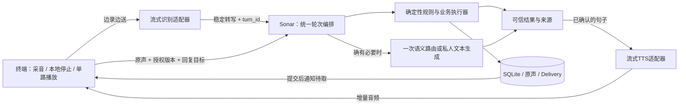

# 声呐低延迟架构优化方案

日期：2026-10-26，Asia/Shanghai。状态：架构方案基线；关键路径与Opus已进入[0.3.0实现](../development/low-latency-opus-20261026.md)，部署与实机验收另列。下文的目标架构和性能预算不表示已经全部完成。

## 1. 决策与范围

保留 FastAPI 模块化单体、SQLite WAL、真人原声和现有授权合同。优先把语音关键路径改成：**一次识别、一个业务决策入口、流式出声、可立即取消**。

本次核对工作区基于 `0949993a689ab02f7839929ee90a63a4745f06b3`，包含已有未提交的 Android 发送阶段等修改；不是对线上 revision 的重新确认。只读了源码、现有记录与官方协议，没有连接手机、查询生产数据库或改变平台配置。已有修改保持原状。

假设：继续支持 Android 与同事独立维护的 ESP32；当前目标是短轮语音交流，继续使用单机业务服务。无需先引入微服务、Redis、消息中间件或 WebRTC。若下一阶段改成持续多人通话，另立媒体传输设计。

本方案的可验证交付是架构、变更边界和验收规格；运行时提速必须以新版本实机数据另行证明。

## 2. 延迟证据与根因

证据为[当天已有的手机时间线](../development/conversation-latency-20261026.md)，不是本次新采样。三轮私人回复从**录音分段结束**到开始播放为 26.166、36.354、38.444 秒。样本少，不能计算可信的 P95 或推断所有网络环境。

最慢一轮：

| 阶段 | 历史实测耗时 | 源码对应与判断 |
| --- | ---: | --- |
| 尾静音 | 默认约 1.2 秒，已包含在分段结束之前 | `SpeechSegments.tailFrames=60`，每帧 20ms；不是下列 38.444 秒中的一项 |
| 本地控制识别 | 1.102 秒 | `LocalSpeechCommands.recognize` 整段处理完成后才启动云识别 |
| 第一次云识别 | 7.022 秒 | `LinxSession.transcribe → exchange(false)`；录完建连接，再按音频时长发送 |
| 上下文/会话核对 | 0.055 秒 | 本轮不是主要瓶颈；位置锁在其他网络条件下可能等待 |
| 业务 HTTP 往返 | 2.074 秒 | 包含网络、上传、路由和服务器处理，不能全部算成模型耗时 |
| 业务结果至私人回复播放 | 28.191 秒 | `private_chat` 再调用一次 `LinxSession.exchange`；重传同一录音；收完 TTS 后整段解码播放 |

最后一段占 38.444 秒的 73.3%。它包含第二次握手、音频发送、上游处理、接收、解码及播放准备，尚不能细分成模型或 TTS 各多少秒。

现有串行路径：

```text
录音结束 → Vosk整段控制识别 → Linx识别（录音按原时长再次发送）
→ HTTP业务决策 → private_chat再建Linx会话并重传录音
→ 等tts.stop → 整段解码成WAV → 播放
```

这条路径使发言越长，结束后的等待也越长。服务端扩容不会消除它。

另有两类问题，应分别计量：

- **正确性**：历史“帮我回复他说可以停车”进入私人聊天、后续分享没有关联原问题。反复重说会放大用户体感等待。当前代码已有 `heard_voice_context` 与显式回复捷径，仍需核对当轮上下文、版本和模型路由，不能仅凭关键词断言根因。
- **真人送达**：Android 每轮依次取 session/inbox，再 `delay(1000)`；周期是请求耗时加一秒，不是精确每秒一次。`exchange_inbox` 对 scene 可能在请求中等语义筛选；question 已有快速放行。不能把所有真人延迟都归为同一个一秒轮询。

## 3. 推荐的目标架构

由声呐服务拥有业务轮次、上下文和动作执行权；识别、文本生成、语音合成通过独立适配器调用。单用户 Agent 是逻辑上下文，不是独立服务进程。



图中流式识别、文本生成和 TTS 的独立适配器是**拟新增边界**。当前仅接通 Linx 一体化语音和 Bamboo 决策，不能把两者直接当成已经可用的通用文本聊天/TTS API。上线前必须验证所选供应商的真实能力、首包时间、授权与成本。

### 3.1 每轮只做一次识别

采音同时把帧交给本地控制、云端识别和本地原声缓冲。音频实时发送的时间与用户说话重叠；业务请求继续保留完整原 WAV，上传给声呐用于业务留证或真人交付不属于重复识别。

本地模型预热，增量处理同一条麦克风音轨。停止/安静保持本地优先；只有完整、足够可信的短指令才能改变状态，不能用局部识别的“别……”提前判定整句意图。

云端 partial 只用于显示和可取消的准备；公开、回复和任务修改仍以稳定转写、完整有界原声及服务端授权复核为前提。若识别供应商没有 final 标记，必须在适配器中声明候选收敛规则和失败边界，不能把第一条 STT 改名为 final。

### 3.2 业务动作只有一个执行入口

HTTP、MCP 和以后新增的实时控制入口共同进入现有 `submit_agent_turn` / 可信执行器。客户端负责音频和本地控制，业务状态归服务器。

顺序为：停止/安静等控制 → 有效且明确的回复对象 → 澄清中的任务 → 明确查询/分享/匹配 → 必要的语义路由。优先级仍须服从用户完整表达，例如“不要回复，帮我查天气”不能因存在回复上下文而公开。

对单轮动作建立共享的类型化路由结果，避免同一句经过多个模型重复解释。保留注意力筛选作为独立任务；复用模型客户端不意味着合并不同用户或不同用途的判断状态。

`heard_post_id`、候选 `reply_to`、context revision 应随录音轮次冻结并由服务端重新验证，而不是提交时任取“最新播放”。有明确回复意图但没有唯一有效对象时，澄清并保持私有，不能降级成独立现场分享。

### 3.3 文本与语音可以流式，业务提交不能靠猜测

私人聊天按句输出已确定的文本，交给流式 TTS；工具查询先得到可信工具结果再说事实；公开成功回执先提交业务再说“已发送”。无需等待完整长回复合成完毕。

Android 用增量解码和 `AudioTrack.MODE_STREAM` 实现语音输出，并接入现有 `AudioCoordinator` 的焦点与单路播放门禁。真人声音继续播放服务器返回的原声，不能用 TTS 替换。

播放器、接收器、编排器需要独立协程。当前 `playSourcedAgent` 会等待 `submitJob.join()`；如果流接收也放在该 job 中，即使增加首帧回调仍会等完整回复，甚至造成互等。应让业务提交完成事件控制播放许可，流接收的完成只决定收尾。

缓冲以音频时长计量，起播窗口按设备与网络实测调节，尊重上游协商参数及系统最小缓冲；设置最大排队时长和总回复上限。网络回调只投递有界队列，不执行阻塞播放。队列溢出显式结束该轮，不能静默丢 PCM/Opus 帧后继续播。

`tts.stop` 是上游生成结束；正常结束需等本地播放排空，才是播完。打断需立即暂停、清空缓冲、丢弃旧 generation 音频。流式播放后，未来的 stop 无法撤销已经听到的内容，因此只能在来源、轮次和业务许可已成立后起播。

`PlaybackEchoGuard` 当前以完整 WAV 建立参考；流式播放器必须同时提供增量参考帧，保留真实 AEC、回声保护和本地打断。只替换播放器而遗漏参考音频会造成自说自答或误公开。

### 3.4 音频和业务交付使用各自合适的通道

语音实时通道负责媒体；现有 HTTP 负责有副作用的业务提交与结果核对。真人新消息增加 SSE“有更新，请取”通知，客户端仍按 Delivery API 取数据、重验和回执；音频继续用鉴权 HTTP 下载。

初期无须把所有业务迁入一个 WebSocket，也无须引入 Redis。持久 Delivery 为事实，单进程内通知只是唤醒：**事务成功提交后**再通知；重连主动拉取并周期补偿，接受重复通知。安静、撤回或到期后，即使通知已发也不能继续播放。

scene 筛选逐步移出 inbox 请求，由有界后台任务生成候选；播放前保留原有规则复核。后台任务需可恢复过期的处理中状态。暂不改变 question 的 conversation_first 行为。

## 4. 近期迁移：先利用现有 Linx，验证后再切适配器

### A. 为现有链路加完整计时

记录同一 turn 下的 VAD 结束、本地控制完成、WSS 发起/hello、上传结束、STT 候选/稳定、业务提交/完成、TTS start/首个可解码帧/stop、实际播放起点/结束及取消。

使用终端单调时钟计算端到端耗时；服务端单独记录排队、锁、路由、工具及提交 span。request_id/turn_id 关联两端，不直接相减两台机器的墙钟。不记录凭证或原始语音正文。

### B. 复用首次 Linx 调用，取消第二次录音识别

这是近期收益最大的候选方案，不必等目标架构全部完成：首次 Linx 调用保留 STT 与回复流，候选按现有保守规则收敛后开始业务提交；若结果为 `private_chat`，放行同一次调用的私人回复；若为查询、发布、回复、控制或澄清，丢弃预生成回复，使用业务结果生成的语音。

流程从“识别 → 业务 → 第二次助手”变为“同次识别/助手运行，与业务分支衔接”。即使暂时保留每条录音一个连接，也能先消除第二次建连和重传；长连接不是这一步的前提。

**启用关口**：该 Linx 配置必须确认不能在预生成阶段调用有副作用的云端业务工具；最简单的是专用无业务工具的私人回复配置。设备 hello 的 `mcp=false` 只是不声明端侧工具，不能据此认为平台挂载的云端 MCP 被禁用。不能验证此条件，就不启用投机回复，先完成 A、流式播放及上行改造，再接独立能力适配器。

预生成回复只适用于普通私人交流，不能声称知道声呐任务状态或已执行工具。它若需要可信业务上下文，由声呐结果提供，不能直接播通用助手的猜测。预生成会消耗最终被丢弃的模型/TTS资源，要测并发、成本与首包收益后再决定覆盖范围。

即便需要在路由期间接收音频，也不能在业务结果前出声；缓冲上限可在超限时终止预生成，不能静默触发旧的第二次录音上传。识别冲突、取消、超时、会话变化均关闭该候选，不自动重发。

### C. 实现增量播放与边录边传

先验证 PCM 增量播放及完整取消，再接 Opus 的有状态增量编解码。现有 `LinxCodec.encode/decode` 输入输出是完整列表，需新增流式接口，不能仅把回调接到整段解码器。

录音期间发送帧，保留起始预帧和有界本地 WAV；Vosk 与云识别并行，只让本地控制阻断动作执行，不让整段识别阻塞网络发送。短指令可能已经传给识别服务，但不得因此执行或公开业务。

不要直接删除现有逐帧 `delay`，假定平台支持无限速上传。实时采集发送本身就能把上传时间与说话时间重叠；录后突发发送是另一个需要平台实验的能力。

### D. 调整端点、业务请求和送达

尾静音以约 600–800ms 为第一组实验值，与当前 1200ms 对照；按噪声、正常停顿、长句和误切率决定是否采用。它是试验参数，不是通用最优值。

私人文本结果保留中文 TTS 引擎实例并预热，避免每次创建和 shutdown；固定回执可预生成，真人内容不进此缓存。重复工具查询按工具自己的时效、地点和用户权限复用结果，不能缓存“别人是否还愿意聊”等易变私人状态。

缩小客户端 `locationMutex` 的范围：位置更新、会话刷新和整段业务 HTTP 当前共享锁。先测锁等待，再以不可变轮次快照及服务端 revision 校验替代不必要的长时间持锁；不取消服务端提交前后的二次核验。

服务端为 Bamboo/地图等上游复用生命周期级 HTTP 客户端与连接池；设置分阶段超时、并发上限和整轮 deadline。没有证据时不归因于 TLS 或连接池。超时只返回已确认的状态，不让旧任务后台继续公开。

最后加交付通知及后台 scene 筛选。它提升真人送达，不能替代私人回复链路优化。

长连接另作后续实验：核验 Linx 多轮、迟到 STT/TTS、abort 后边界和重连行为。现有公开协议未给出可依赖的业务 turn_id/final 契约，因此保留每连接单在途轮次；边界不明确时销毁连接，不能把旧结果归给新轮次。

## 5. 模块改动和职责

以下是建议拆分，尚未创建对应代码：

| 责任 | 建议改动 | 验收产物 |
| --- | --- | --- |
| Android 音频 | `ExchangeCapture` 增加帧分发；新增 `StreamingAgentPlayer`；`LinxCodec` 增量接口；扩展回声参考 | PCM/Opus增量播放、焦点打断、无回灌、缓冲有界 |
| Android 会话 | 从 `ExchangeService` 提取 `TurnOrchestrator`；改造 `LinxSession` 事件流；分开业务提交与媒体接收生命周期 | 单轮一次识别、分支许可、取消旧generation、请求不盲重发 |
| 后端业务 | 沿用 `submit_agent_turn`，增加共享路由结果、明确回复目标合同和分阶段 span | 正确关联回复，权限/版本/隔离回归 |
| 平台接入 | 专用无业务工具配置或独立 STT/文本生成/TTS 能力验证 | 真实协议抓取的事件顺序与耗时、无重复工具副作用 |
| 后端交付 | 提交后通知、补偿拉取；有界后台 scene 筛选 | 断线重连不丢待取项、不播过期项 |
| ESP32 同事 | 按验证后的媒体事件、取消与业务合同适配 | 独立板卡版本、扬声器与断网实测 |

保留现有六要素消息、真人原声、授权范围、每用户任务、幂等 UUID、revision、未知结果核对和“播完不等于解决”。音频状态新增可观测事件不代表改变业务事实。

## 6. 性能预算与验收

主指标定义为**用户有效语音结束 → 首个有内容的可听回答**，包含端点等待；提示音、“正在处理”或静音不算回答。另记分段结束指标，才能与当天旧日志对照。首包到达与播放器开始只是软件代理指标，设备实际出声另验。

以下是设计目标，不是测量结果或承诺；独立供应商能力与真实网络验证后再冻结 SLO：

| 里程碑 | 目标 |
| --- | --- |
| 近期复用同轮语音、增量播放 | 普通私人回复 P50 ≤ 8 秒；消除第二次音频识别，并证明实际等待下降 |
| 目标架构热态、普通私人回复、无外部工具 | P50 ≤ 2.5 秒，P95 ≤ 5 秒 |
| 天气/路线等查询 | 按工具分别统计；建议 P50 ≤ 4 秒，P95 ≤ 8 秒；上游失败有界结束 |
| 本地停止/安静 | 指令确认后软件停止播放 P95 ≤ 200ms；另记用户说完到本地指令确认耗时 |
| 真人交付 | 持久 Delivery 可用后到另一端出声，建议 P95 ≤ 2 秒；不包含真人思考与录音时间 |

热态私人回复的初始关键路径预算示例：端点 600ms + 识别收尾/受控业务提交 500ms + 文本首句 1000ms + TTS首音/起播 400ms = 2500ms。它要求上行已与说话重叠、没有重复识别且业务简单分支不串行等待语义模型；不是把组件 P95 相加得出的端到端 P95。

按普通聊天、查询、明确回复、分享和控制分别统计；热态、冷启动、Wi-Fi、移动网络、长短发言分别报告。每个核心可比条件建议至少100轮，记录失败、超时、取消及样本数量；失败不能从分母消失，单独报告成功率与成功样本延迟。

软件验证至少覆盖：同轮只启动一次识别；tts.stop前可起播；收到stop不提前报告播完；cancel清空待播且迟到帧失效；用户/轮次/原声隔离；回复对象失效时不变分享；未知提交不重发；断开通知后补取；接收溢出与音频焦点丢失。

发布验证记录 APK/后端 revision、平台配置版本、迁移备份与回滚开关。设备验证分别记录 Android/ESP32、系统、网络、噪声、锁屏与真实扬声器；车内误触发和用户可理解性独立验收。此前用户确认和旧测试不能充当新链路验收。

## 7. 实施排序与暂缓项

1. **先做**：细分计时与基线；以“停车回复”等真实语义补充回复上下文回归。可以并行推进规格，代码按独立变更审阅。
2. **最高收益**：验证平台无副作用前提，复用首次语音调用，取消第二次录音识别；实现增量播放和取消。
3. **持续提速**：边录边传、增量本地控制、端点实验；保守验证轮次边界。
4. **业务与交付**：统一路由输出、TTS预热、连接池、缩小锁范围、交付通知。
5. **目标演进**：平台能力允许后，切换独立STT/文本生成/TTS适配器，明确由声呐持有私人上下文和业务执行权。

暂缓数据库迁移、多进程、微服务和媒体技术栈重写。当前 `Service.scope/async_scope` 都进入 `BEGIN IMMEDIATE` 并做过期处理，读接口也可能竞争写锁，后续应计量锁等待并拆分真正只读操作；WAL不等于多写并发。这是扩量风险，现有小样本不能证明它造成了16–28秒私人回复等待。

## 8. 源码与协议依据

- 当前实现：[模块规格](module-specs.md)、[Linx接入记录](../development/linx-android.md)、[耗时时间线](../development/conversation-latency-20261026.md)。
- Android：`ExchangeService.kt`（两次调用、播放等待、轮询与位置锁）、`LinxSession.kt`（逐帧发送、整段缓冲）、`LinxCodec.kt`、`SpeechSegments.kt`、`LocalSpeechCommands.kt`、`AgentSpeech.kt`、`AudioCoordinator.kt`、`PlaybackEchoGuard.kt`，均位于 `android/app/src/main/java/com/sonar/app/`。
- 后端：`server/app/exchange.py`（轮次两阶段提交、inbox筛选）、`voice_first.py`（上下文和意图）、`agent.py`、`service.py`、`storage.py`。
- [Linx官方WebSocket协议](https://linx.qiniu.com/docs/xrobot/platform/websocket)：确认支持二进制音频与TTS状态；这些能力支持流式改造方向，但不能证明本项目长连接或独立文本入口已兼容。
- [Android AudioTrack官方文档](https://developer.android.com/reference/android/media/AudioTrack)：确认流式写入以及暂停/清空待播数据的API行为；设备延迟仍须实测。
