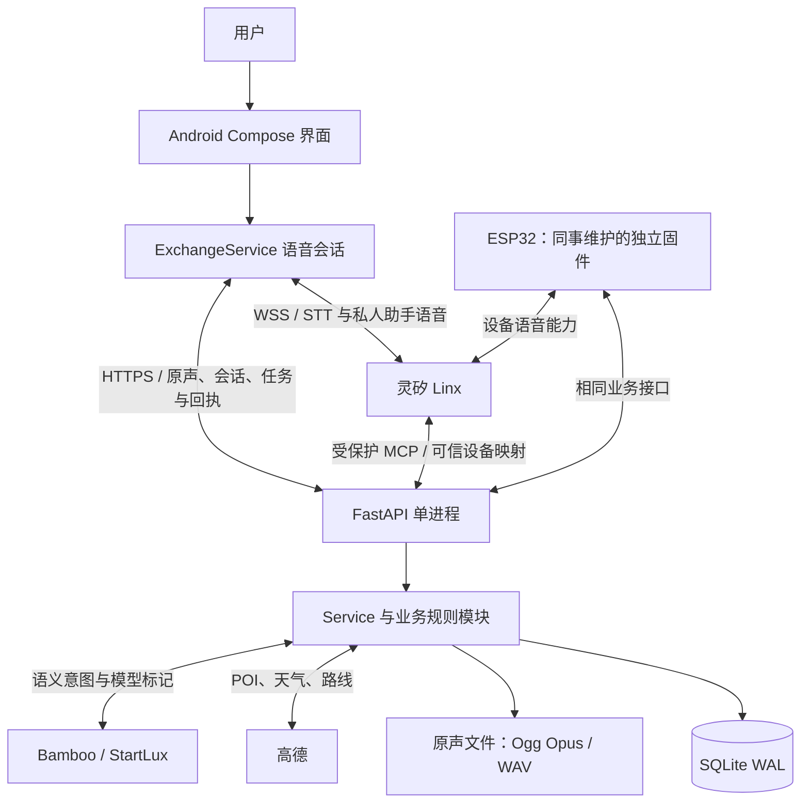
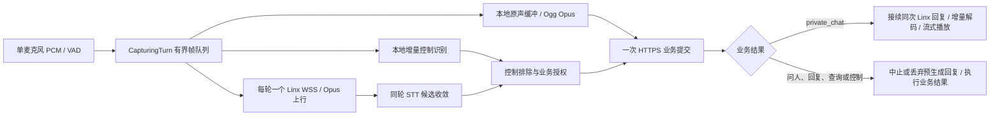

# 声呐 Sonar｜当前实现架构、模块规格与分工

核对日期：2026-10-27（Asia/Shanghai）。源码基线为 `2dce542`，Android **0.3.6/code17**；本次只读复核生产目录为 **`20261027-modaily-alias-040`**，服务 active、健康检查通过，OpenAPI `info.version=0.3.0`。API版本、Android版本与部署目录分别记录，不要求编号相同。ESP32子模块固定公开主线 **`60e1a1e`**，不表示实体设备已烧录该提交。

本文件为当前实现的架构入口；[低延迟方案](low-latency-architecture-20261026.md)保留目标与历史瓶颈，[实现记录](../development/low-latency-opus-20261026.md)、[手机平台与Opus修复](../development/voice-start-fix-20261026.md)、[最新双端验收](../development/esp32-reply-failure-20261027.md#040之后的真实往返)分别提供交付证据。[产品架构](product-architecture.md)中的完整事件系统、治理与商业试点仍为规划。启动、构建和配置见[运行指南](../RUNNING.md)。

## 1. 部署与调用关系

自有服务是单机单进程模块化单体，不为每个用户启动独立 Agent 服务。`Service` 通过规则类组合业务能力；复用方法不意味着共享用户任务、授权或私人上下文。Caddy 负责公开入口，systemd 或备选 Compose 管理进程。手机录放、云端语音和业务 API 是可独立失败的链路。

### 低延迟语音关键路径

采音、本地控制识别与云端传输重叠，私人聊天不再第二次上传同一录音；WSS仍每轮建立，不宣称跨轮复用。`AudioCoordinator`约200ms起播缓冲，正常结束等待实际播放排空，安静/结束清空待播音频。保留1.2秒VAD尾静音与STT候选收敛检查；没有供应商保证的final转写时不假定它已经final。原声播放、合成回复和系统提示共用单路播放门禁。

终端托管会话由Sonar HTTP拥有业务执行权；平台Agent须先移除会重复执行动作的工具，再由运营加入`SONAR_MANAGED_VOICE_VERIFIED_AGENTS`。本次生产只读核对：Android/Alice的`client_managed_voice=true`，ESP32/Bob为false；两者上传格式均为`wav`、`ogg_opus`。这是各自平台接入方式的差异。托管会话期间及其迟到回调的Sonar MCP写操作被拒绝，第三方平台工具仍需独立隔离。

HTTP上传/存储使用单声道Ogg Opus，Android目标24kbps；Linx WSS使用hello协商的裸Opus包，不能直接发送Ogg文件。下载按原格式返回`audio/ogg`或`audio/wav`，历史WAV不批量转码；Android两者均可播放，固件须按实际格式解封装/解码。5秒合成样本从160,044字节降至22,503字节，减少85.94%，不代表所有录音的固定压缩率或车内音质。[格式合同与隔离HTTP验证](../development/opus-interface-20261026.md)。

## 2. 服务端模块规格

普通车位询问在会话已授权问人且地点明确时，直接提交本轮原声，即使已有回答也不静默改为私人查询，不再追问是否询问在场的人。明确说“查一下／只想知道／不问人”的车位查询保持私有，查无信息也不自动公开。真人原声来源的私人查询返回可执行的play_audio动作，保留来源和时效校验。Android 提示“正在将问题转发给〔地点〕在场的人”，设备接收状态仍以实际回执为准。地点缺失或同名歧义仍需澄清；其他私人查询的工具失败继续沿用原有问人确认。

下表“负责角色”为交接所需的责任划分，具体成员姓名未在本项目中确认。

| 模块 / 源码 | 输入与输出 | 持久状态与关键约束 | 负责角色 / 验证入口 |
| --- | --- | --- | --- |
| HTTP 边界：`main.py`、`models.py`、`errors.py` | Bearer、JSON/multipart → 类型校验后的业务调用、结构化错误或音频 | 有界上传；不记录凭证或语音正文；身份由服务端解析 | 后端 / `test_core.py`、`test_audio_trace.py` |
| 统一契约：`contracts.py`、`message_views.py` | 旧消息、会话能力与动作 → v1 六要素消息和统一结果 | 保留来源与原声；未知字段不补造；HTTP/MCP 复用合同 | 架构与后端 / `test_contracts.py`、`test_agent_commands.py` |
| 服务编排与身份：`service.py` | 可信用户、配置及业务动作 → 任务、消息与交付 | 用户 Token 存摘要；Alice/Bob 分离；事务中重查权限、版本和时效 | 后端 / `test_core.py`、`test_async_storage.py` |
| 会话与原声轮次：`exchange.py` | 分项授权、会话 revision、转写及原声 → 私有回应、公开发言或控制结果 | 会话、轮次、幂等请求；过期/撤销/安静规则；模型异常不自动公开 | 后端 / `test_exchange.py`、`test_conversation_first.py` |
| 语音优先动作：`voice_first.py` | 明确控制语句、地点及模型候选 → 可执行计划和音频项 | 目标地点消歧；私人查询、问人、分享、回复与收听能力分别核验 | 后端与交互 / `test_voice_first.py` |
| 个人 Agent 与工具路由：`agent.py` | 当前轮次、私有上下文、天气日期/地点 → 工具来源、澄清或私人聊天 | “我想闲聊”进入本人 Agent；“找车友聊聊”进入真人匹配；缺少事实不伪造现场回答 | 后端 / `test_agent_network.py`、`test_information_tools.py`、`test_conversation_first.py` |
| 自愿真人聊天：`chat.py` | 双方意愿、参与者、会话及短语音 → 配对、消息、交付及退出 | 仅参与者访问；使用返回的 chat 音频 URL；任一方退出/安静均要复核 | 后端与终端 / `test_agent_network.py`；持续设备聊天另验 |
| 有效信息检索：`information.py` | 用户、POI、用途及查询 → 有权限且仍适用的公告/观察/知识 | 查询不公开私人输入、不制造到场；播放前可再次验证来源有效性 | 后端 / `test_retrieval_tasks.py`、`test_standing_notices.py` |
| 个人任务：`tasks.py` | 原请求 UUID、任务 ID、revision、明确动作 → 等待/回应/解决/取消状态 | 一人一份任务；有限邀请；未知结果用原 UUID 核对；听完不自动解决 | 后端 / `test_retrieval_tasks.py` |
| 地点与远程范围：`geo.py`、`remote_places.py`、`place_migration.py` | GPS 样本或明确远程 POI → 地点、资格、园区范围及工具结果 | GPS 与远程身份分开；坐标时效和精度校验；迁移保留历史 | 后端与定位 / `test_location.py`、`test_remote_places.py`、`test_place_migration.py`、`test_park_questions.py` |
| 声音与公告：`voices.py` | 录音、用途、频道授权及有效期 → 公开声音、替代/撤回、收听项 | 运营权限按频道核验；长期须知需明确 validity_policy；合成来源单独标记 | 后端与运营 / `test_voice_matching.py`、`test_standing_notices.py` |
| 注意力与模型：`decision.py`、`attention_worker.py` | 合法候选与本人关注 → 模型 notify/defer/ignore 标记 | 当前有效 question 邀请采用 conversation_first，模型不阻断；安静、资格、权限和期限仍是硬约束；scene 保留相关性筛选 | 后端与模型接入 / `test_attention_flow.py`、`test_decision.py`、`test_conversation_first.py` |
| 音频与持久化：`audio.py`、`storage.py`、`schema.sql` | Ogg Opus或完整WAV与事务操作 → 不可变音频及一致数据库 | 单声道Opus或16kHz/16-bit PCM，实际解码最长30秒；文件最多1000KiB，multipart总体1MiB；压缩原声原样保存/下载；SQLite WAL与外键 | 后端 / `test_opus.py`、`test_core.py`、`test_async_storage.py` |
| MCP：`mcp.py` | 独立 Bearer + 可信 Device/Agent/Session → 受限业务工具 | Streamable HTTP 与旧 SSE；每次核验身份和归属；无设备上下文不能操作个人状态 | 平台接入与后端 / `test_mcp.py`、[平台记录](../development/linx-platform.md) |
| 信息时效：`service.py`、`day_validity.py` | 发布时刻、信息类型与策略 → 截止时间及显式迁移 | 生产普通动态信息按北京时间发布当日24:00截止；线程受原问题截止限制；长期公告直到撤回；定位/会话时效独立 | 后端 / `test_day_validity.py` |
| 配置、导入与运维：`config.py`、`cli.py`、`operator_cli.py`、`demo_audio.py`、`poi_notices.py` | 本地配置、授权命令与合成素材清单 → 初始化、授权或幂等导入 | 凭证不入库明文、不输出；素材哈希核对；导入须显式执行 | 后端与发布 / `test_demo_audio.py`、`test_standing_notices.py` |

源码位于 `server/app/`，测试位于 `server/tests/`；文件均相对仓库根目录。完整字段以 [v1 Schema](../development/contracts/v1/schemas.json)、[契约说明](../development/contracts.md)及运行时 `/openapi.json` 为准。

## 3. Android 模块规格

源码目录为 `android/app/src/main/java/com/sonar/app/`。

| 模块 / 源码 | 职责与输入输出 | 状态、约束与负责角色 |
| --- | --- | --- |
| 界面：`MainActivity.kt`、`SonarScreen.kt`、`ExchangePanel.kt`、`VoicePanel.kt`、`LinxPanel.kt` | 准备、开始、活跃/安静状态、地点及设置 | 用户显式开始，不把配置过程混入行车交流；Android/体验 |
| 界面编排：`SonarViewModel.kt`、`Models.kt` | API/配置/定位结果 → UI 状态与用户动作 | 不把请求成功等同实际播放；Android |
| 前台语音运行：`ExchangeService.kt` | 采集轮次、STT、服务端动作、轮询交付 → 私有回应或原声播放 | 用户动作启动；通知/生命周期管理；非 sticky 重启；本地安静与终止优先；Android |
| 音频：`AudioCoordinator.kt`、`ExchangeCapture.kt`、`SpeechSegments.kt`、`OpusFiles.kt`、`UploadAudioCache.kt` | PCM帧、VAD、音频焦点、Ogg Opus → 有界录音、压缩传输或流式播放 | 单麦克风/单路播放、系统打断、单轮上限和静音边界；流式回声参考；Android/音频 |
| 本地控制与回声：`LocalSpeechCommands.kt`、`PlaybackEchoGuard.kt` | 离线中文识别与播放上下文 → 控制动作或回声抑制 | Vosk 固定校验；网络失败仍需本地停止；真实车内 AEC/误触发单验；Android/音频 |
| 反馈与来源：`VoiceFeedback.kt`、`AgentSpeech.kt`、`SourcePresentation.kt` | 提交结果、Agent 文本、来源信息 → 回执提示、中文 TTS 和显示 | 真人回复保留原始Ogg Opus/WAV；Agent使用合成语音；原声增益为播放派生，不覆盖服务器原文件；Android |
| 业务网络：`SonarApi.kt` | 业务 Token、冻结请求 ID/revision → HTTP 结果或已鉴权音频 | 不混用灵矽凭证；不凭旧版本播放；Android/后端共同维护契约 |
| 灵矽接入：`LinxGateway.kt`、`LinxSession.kt`、`LinxCodec.kt`、`CapturingTurn.kt`、`StreamingOpusEncoder.kt`、`StreamingOpusDecoder.kt` | 设备绑定、实时帧与WSS → 同轮STT/流式私人回复 | 一轮一次识别，业务结果控制出声；OTA/WSS身份独立；超时不自动公开；Android/平台接入 |
| 本地状态：`TaskStore.kt`、`AckReconciler.kt` | 私有设备配置、草稿、回执 → 加密配置和重试台账 | Keystore 保护配置；任务按服务器/用户范围隔离；未知结果核对、不盲目重发；Android |
| 定位：`PhoneLocation.kt` | 系统定位与精度 → 明确位置样本 | 权限、时效、真实位置/远程选择区分；Android/定位 |

JVM 规则测试位于 `src/test/`；Android runtime、界面和可选真实链路测试位于 `src/androidTest/`。测试资源与生产资源分开，旧 Mock 及内置地点演示素材已移除；服务端合成示例不赋予设备真实到场资格。

## 4. 接口与数据所有权

| 业务边界 | 主要接口 | 状态所有者与规则 |
| --- | --- | --- |
| 身份、位置、收听 | `GET /v1/me`、`PUT /v1/me/location`、`PUT /v1/me/remote-place`、`PUT /v1/me/listening` | 服务器核验本人；当前位置、远程地点与私人目标分开 |
| 会话、语音轮次 | `POST /v1/agent/sessions`、`POST /v1/exchange/sessions/{sid}/utterances`、`POST /v1/agent/sessions/{sid}/turns` | 授权属于本人会话；轮次保留请求 UUID、revision 和原声 |
| 信息、消息、任务 | `POST /v1/information`、`POST /v1/information/validate`、`GET /v1/messages/{id}`、`GET /v1/tasks`、`POST /v1/tasks/{id}/actions` | 公共来源按权限检索；个人等待和结束独立保存 |
| 结果核对 | `GET /v1/requests/{request_id}` | 原请求的结果不确定时先核对，不用新 UUID 重发 |
| 收件、音频、回执 | `GET /v1/exchange/sessions/{sid}/inbox`、`POST /v1/inbox/{did}/ack`、`GET /v1/audio/{pid}`、`GET /v1/chat/audio/{mid}` | 使用返回的音频 URL、delivery ID 与 request_id；播放前重查，听完才报告 |
| 手动发布与声音 | `POST /v1/posts/drafts`、`POST /v1/posts/{pid}/confirm`、`POST /v1/voices/{pid}/withdraw` | 手动草稿经 confirm 公开；自然会话采用独立明确授权；撤回/到期不能继续自动播放 |

消息六要素包含时间、地点、主体、事件、语音正文、状态。当前通过消息投影和契约适配提供这些信息；它不表示已经建成完整事件图谱。私人助手对话、个人任务、会话授权和每位收件人的 Delivery 相互独立。`已发布`、`已收到`、`已听完`、`需求已解决` 是不同事实。

网络或上游调用放在可控计划阶段，数据库事务负责原子状态更新；外部结果落地时再次核验会话有效性、任务版本和权限。服务重启后重新获取短期候选，持久化任务和回执用于核对，不能从旧内存快照继续执行。

## 5. 跨模块分工与交接

| 负责角色 | 交付物 | 对接方 / 验收责任 |
| --- | --- | --- |
| 产品与架构 | 产品定义、消息/动作/授权合同、当前与规划边界、验收场景 | 后端、Android、固件共同审阅合同；产品确认用户结果 |
| 后端 | HTTP/MCP、身份、状态规则、检索、任务、音频、模型/地图适配、数据迁移 | 给两端提供固定 Schema 与 fixture；完成隔离测试和部署证据 |
| Android | 可构建源码、APK、配置保护、语音运行与回执、设备诊断 | 与后端核对请求/交付；设备使用者确认实际听到与可控性 |
| ESP32/硬件同事 | 独立固件源码、板卡/音频参数、构建烧录命令、版本和设备日志 | 使用[当前交接书](../development/esp32-ai-handoff.md)；同事更新原仓库，本项目通过[固件子模块](../../firmware/README.md)固定版本 |
| 平台与模型接入 | 灵矽设备绑定、MCP 身份、真实 STT/TTS 与模型配置 | 凭证私下配置；平台成功不等于产品原声播放验收 |
| 发布与运维 | 版本清单、配置/数据备份、单进程服务、代理、健康检查、回滚 | 代码检查、部署核对与实机结果分别记录；不以历史发布状态代表当前在线状态 |
| 测试与参与者 | 隔离软件验证、双人原声、真实位置、断网/静音/重启、车内声学 | 记录环境、revision、持久状态、实际结果；真人与设备分别签收 |

## 6. 当前交付与已知边界

| 层次 | 当前证据与限制 |
| --- | --- |
| 源码与软件检查 | Android0.3.6/code17、服务端当前源码已纳入Git；最近完整记录为284项服务端测试及Ruff、64项Android JVM测试及Lint/构建。此次文档同步未重跑应用测试 |
| 生产 | 本次只读确认040仍在线、健康正常，OpenAPI下载列出WAV/Ogg，手机托管语音已放行，ESP32保持独立配置；此次未部署、修改配置或写入演示内容 |
| Android实机 | 0.3.6已安装；删除旧问题后启动恢复3项真机回归通过，手机Opus上传和私人流式回复已有实测，见各日期记录 |
| 双端真实听感 | 2026-10-27用户确认现有Android自动播问题、现有ESP32播回答，一轮双向闭环通过；设备回执与用户确认分别记录，不据此推定长期稳定性 |
| 固件源码与实体设备 | 公开仓库`ma6174/ai-passport`的`main`固定60e1a1e，含Sonar及异步Ogg播放修复；主机/构建门禁通过，该固定版本未烧录。现有板子运行版本未核实；本地旧候选补丁另存，不混入主线 |
| 性能与未来工作 | 尚无最新版本同机同网30轮P50/P95和失败率验收，不能宣布达到低延迟目标。SSE业务通知、后台scene筛选、独立STT/文本/TTS适配器、VAD调参仍待实现/验证；长时间运行、弱网、锁屏、车内AEC和板端内存余量另验 |

当前仓库覆盖Android、服务端、测试、脚本、依赖锁定、部署模板、协议、工程/产品文档和路演资料；外部Linx、高德、Bamboo的实现源码与凭证不属于本仓库。固件获取及构建见[固件入口](../../firmware/README.md)。多进程扩容、实时多人对讲、完整事件治理和商业试点不在当前交付范围内。
