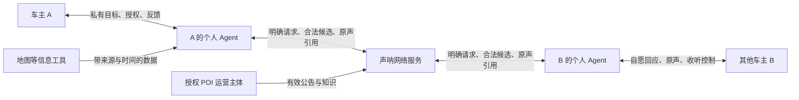
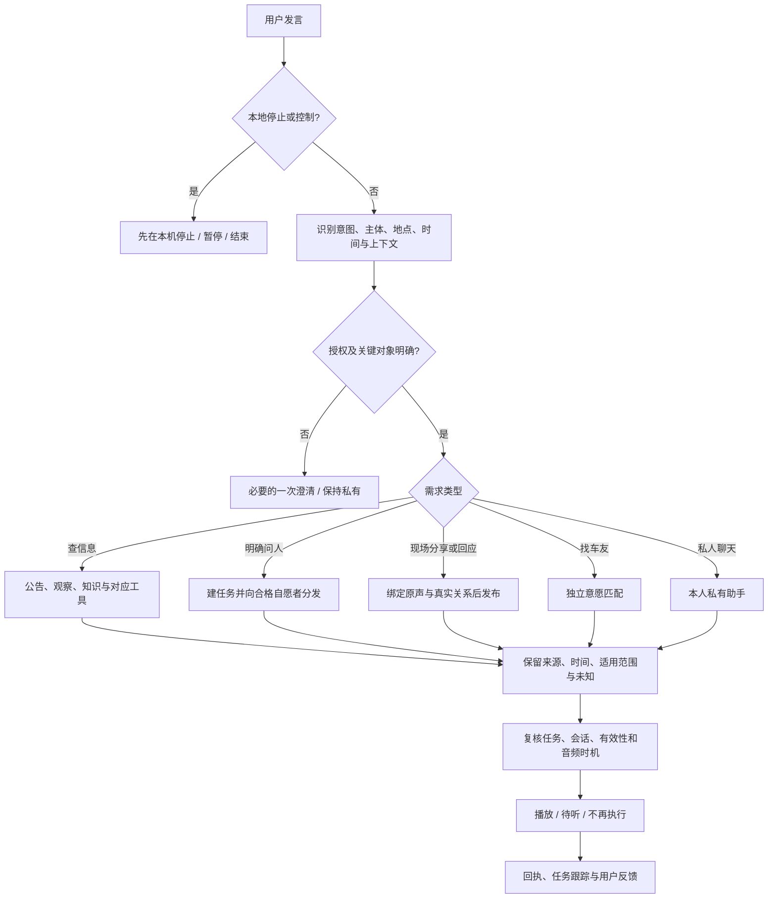

# 声呐 Sonar｜产品定义与功能架构

日期：2026-10-25。状态：下一阶段产品设计基线，包含建议决策，尚不代表功能交付。

后续实施：SNR-001 和 SNR-002 已完成本地契约与应用执行入口，见[实现与分层验证](../development/snr-001-002.md)。下文第 8 节保留规划时的代码快照；新进展不倒写历史证据。

本轮输入：用户明确语音网络由「车主、车主 Agent、其他车主、其他车主的 Agent」组成；语音信息包含「时间、地点 POI、主体、事件、语音正文、状态」。本文在现有产品和工作区代码上补全，供后续开发使用。[任务与验收](../planning/sonar-development-backlog-20261025.md)与本文配套。

## 1. 产品定义

**声呐是以车主个人 Agent 为入口，围绕时间、地点和事件，连接车主原声与有来源的信息，并管理需求、回应和收听时机的语音网络。**

对用户的表达：**说出你关心的事，让声呐帮你找到消息、找到在场的人，并等到回应。** 延续「听见同路的声音」。

用户从当前位置、沿途或目的地提出需求；自己的 Agent 理解并选择信息来源，必要时把明确的请求交给其他车主的 Agent。对方 Agent 根据主人的授权、现场资格和参与意愿决定是否邀请其回应。真人回答保留原声，经网络回到请求者；Agent 在合适时机安排播放、追问或结束任务。其他人主动留下的地点声音，也可以被需要它的用户发现。

产品成功取决于三个结果：用户得到有用且仍适用的信息；愿意回应的人付出很少操作；双方可掌握交流边界与节奏。音频数量、Agent 调用次数和消息送达量只能说明活动量。

### 范围与假设

| 性质 | 本轮采用的边界 |
| --- | --- |
| 用户已明确 | 四类相对主体；六类语音信息要素；在现在基础上补全并形成开发任务 |
| 沿用项目决策 | Android / ESP32 为语音终端；一次授权内自然现场交流；真人原声；安静和关麦控制；单机业务服务；个人状态隔离 |
| 建议的首个完整闭环 | 车主远程询问一个明确 POI 的情况，优先利用有效信息，缺少时联系在场且愿意回应的人，收到原声并可追问 |
| 建议的供给起点 | 一个授权 POI 加少量自愿参与车主；POI 运营方提供基础信息，车主提供补充观察。尚无首个试点已落实的证据 |
| 下一阶段保留边界 | 异步短语音；先验证一个主终端和有限活跃任务；导航上下文、同路同方向匹配、后台可达性按实际能力提供 |
| 后续独立立项 | 实时多人对讲、交易撮合、车辆控制、全城市覆盖、主机厂量产集成；不由本次产品整理推定已具备 |

## 2. 网络主体与职责

四类主体是站在车主 A 的视角描述两个相同结构的节点，并不需要四套账号系统。每个车主节点由「人 + 个人 Agent + 已授权终端」构成；其他车主 B、C 的结构相同。

网络服务负责可信身份、内容、权限、匹配和交付；个人 Agent 代表某个具体用户处理任务。图中的逻辑角色可共用一个服务部署，无须每人运行独立进程。POI、车辆和设备是业务对象或入口；经授权的运营人员是补充信息供给者。

| 主体 | 负责 | 可决定 | 边界 |
| --- | --- | --- | --- |
| 车主 A | 表达需求、现场观察、授权、评价 | 问什么、是否公开、是否参与、什么时候安静 | 私人助手对话默认保持私有 |
| A 的 Agent | 理解目标、检索、委派请求、跟踪、收听调度 | 在授权内查什么、问谁、何时播放或暂缓 | 不编造现场事实，不替其他人同意参与 |
| 其他车主 B | 提供亲历观察或自愿交流 | 是否回应、说什么、是否退出 | 在附近与愿意回答是两项条件 |
| B 的 Agent | 管理 B 的请求、邀请和注意力 | 是否提示 B；是否交付已获授权的既有内容 | 不泄露 B 的私有偏好、目的地、原始定位或助手记忆 |
| 授权 POI 运营主体 | 维护其范围内公告与知识 | 发布、替代、撤回、设定有效期 | 频道或地点身份由服务端授权，不由模型或自称授予 |
| 声呐网络服务 | 管理内容、关系、来源、候选和回执 | 权限、有效性、确定性路由、版本校验 | 共享实现不意味着共享个人状态 |

### 四种交互关系

1. **人 ↔ 自己的 Agent：**私有查询、助手聊天、授权和控制。一般不产生公共声音。
2. **Agent ↔ Agent：**在可信服务中交换结构化任务、邀请、已公开内容的引用及处理结果。首版使用既有任务/交付机制表达，不需要模型之间自由对话。
3. **人 ↔ 人：**通过两个 Agent 中转真人原声，可为公开问答、定向公开回复或仅参与者可听的车友交流。
4. **运营方／信息工具 → Agent → 人：**提供有来源、时间和适用范围的信息；工具回答使用 Agent 身份和合成语音，不能冒充真人回复。

Agent 可在授权内代发本人的明确现场发言；可引用主人已经公开且仍有效的观察。把未公开原声或私有记忆授权给其他人，是另一项权限，默认关闭。首阶段不做无人授权的跨 Agent 事实代答。

## 3. 用户需求与业务闭环

| 业务线 | 典型表达 | 核心对象与闭环 | 首阶段边界 |
| --- | --- | --- | --- |
| 现场信息问答 | 「帮我问问世纪公园停车场还有位吗？」 | 需求 → 地点澄清 → 有效信息查询／现场邀请 → 原声回答 → 追问 → 用户结束或到期 | 提问者可在远处；回答资格校验现场证据 |
| 地点声音 | 「听听这里的故事」「这里看落日很漂亮」 | 留声 → 确认适用地点与时间 → 合法检索／情境匹配 → 收听与反馈 | 历史感慨注明时间，不作为当前天气或车流事实 |
| POI 公共信息 | 「B2 满了，请去 B3」「这里哪个入口能进？」 | 授权发布 → 版本生效 → 主动查询／到达匹配 → 播放前复核 → 撤回／替代／到期 | 静音仍生效；二维位置不声称识别到楼层 |
| 车友交流 | 「找个车友聊聊」 | 双方分别表达意愿 → 匹配 → 参与者原声交流 → 任一方结束 | 异步短语音；暂不承诺实时通话、同路或同目的地 |

私人助手是这四条业务线的统一入口和私人服务能力。它的闲聊内容不进入声音广场。沿用当前[语音网络设计](voice-network.md)：「我想闲聊」先寻找明确愿意聊天的真人，未匹配时只询问一次是否接受 Agent 陪聊；拒绝就不开始 AI 陪聊。明确「和 AI 聊聊」应直接进入私人助手，不绕到真人匹配；这条显式意图的覆盖纳入统一入口任务。

### 代表性流程：远程询问停车情况

1. A 说「前面景区还有停车位吗？」。没有可用行程上下文时，Agent 简短问具体景区；不使用预选交流地点替代。
2. 确认 POI、问题及需要的时间范围。当前位置、目标地点、是否已到达分别保存。
3. 检索该 POI 的当前公告、有效现场观察及已有相关回答。普通知识、区县天气、路线路况不能替代实时车位。
4. 找到适用信息时说明来源和观察／更新时间，必要时播放原声；信息冲突则保留不同来源，不生成一个无依据的确定结论。
5. 仍需现场回答且用户已明确要求问人／已有对应授权时，建立任务，向符合条件且愿意互助的人有限分发。仅授权私人查询时，另问一次是否向现场车友提问。
6. B 的 Agent 筛选邀请。B 自愿回答「我在西门，刚看到还有几个位」，原声绑定真实请求与对应范围。
7. A 的 Agent 在可播放空隙接续原声。A 离开起点不取消等待；B 的观察到期则不继续当作当前事实自动播。
8. 「收到回答」「开始播放」「听完」「用户认为已解决」分别记录。A 可以追问、更换需求或结束；无人回答时保留真实超时状态。

## 4. 六类信息要素：统一语音消息

六要素是消息的业务结构，不是六个字符串字段。一个消息引用原声、地点、事件和会话；个人任务与每个收件人的状态独立保存。不是每条消息都有 POI 或事件：私人闲聊允许为空，并记录未知原因。

| 要素 | 最小结构 | 规则 |
| --- | --- | --- |
| 时间 | `observed_at`、`recorded_at`、`published_at`、`valid_from`、`valid_until` | 观察时间可能未知，不用上传时间补造；动态信息有有限有效期；长期知识保留更新时间；服务端记录接收时间用于排错 |
| 地点 POI | `about_place_id`、`recorded_location_ref`、`scope`、`direction`、`place_resolution` | 内容所指地点与录音位置分开；接收者实际位置和私人目的地留在个人上下文；方向、入口、楼层未知就标未知 |
| 主体 | `author_id`、`principal_id`、`acting_agent_id`、`source_type`、`mentioned_entities` | 谁发声、替谁执行、正文说到谁分别记录；身份来自可信会话；运营身份另查授权；对外使用适当显示名 |
| 事件 | 可空的 `event_id`、`event_type`、`claim`、`event_relation` | 区分谈论的现实事件、问答线程和个人任务；消息是一次观察／询问／更新，不自动成为已核实事实 |
| 语音正文 | `audio_ref`、`transcript`、`transcript_revision`、`content_origin`、`source_refs` | 真人原声、转写、Agent 摘要分别标识；提取结构不改写原声；原始文件及派生版本可追溯 |
| 状态 | 内容发布、信息适用、事件、任务、交付、授权、审核各自的状态 | 不使用一个 `status` 同时代表所有对象；聚合界面由对象状态推导 |

还需补齐三组关系：

- **用途：**`speech_act` 表示提问／回答／观察／解释／告知，`topics` 表示话题。现有 `kind` 保留兼容，不立刻改成新枚举。
- **访问：**`visibility`、`recipient_ids`、`channel_id`。定向给某人和仅某人可见是不同属性；公开回答的收件人明确，并不因此变成私聊。
- **关联：**`conversation_id`、`reply_to_message_id`、`task_id`、`replaces_message_id`。地点和语义相似不能生成真实回复关系。

`source_type` 区分个人观察、授权运营、外部工具；`content_origin` 区分真人录音、Agent 合成、派生摘要。运营人员也可上传真人原声，因此来源与音频形式不能合并成一个枚举。媒体／乘客来源无法确认的内容不自动公开。

### 同一地点、事件、会话和任务的区别

| 对象 | 回答的问题 | 例子 |
| --- | --- | --- |
| POI / Place | 在哪里、适用于哪个范围？ | 世纪公园西门停车场；道路可用地点区域表达，暂不伪装为精确路网 |
| Event | 现实中发生了什么、现在是否仍适用？ | 西门停车场本次满额状态及后续恢复 |
| Message | 谁在什么时候说了哪一句？ | 「10:05 西门还有几个位」及其原声 |
| Conversation | 哪些发言在真实接续交流？ | A 的提问、B 的回答、A 对西门的追问 |
| PersonalTask | 某个用户还在等什么？ | A 等车位回答；C 单独关注同一停车场 |
| Delivery | 某条声音对某个人处理到哪一步？ | B 的回答交给 A，A 尚未听完 |
| ExchangeSession | 这一段时间允许 Agent 做什么？ | A 本次允许公开现场观察，自动听相关回复 |

一个事件可被多个独立会话谈论，一个会话可逐步涉及多个事件。个人任务可以引用多条证据；任务取消不删除别人的内容或其他人的任务。事件模型首版只做「类型 + 地点范围 + 时间段 + 证据消息」；不引入图数据库或全量知识图谱。

### 事件演化与冲突

现实事件状态采用相应类型的词汇，例如车位「有位／紧张／满额／未知」，道路「缓行／封闭／恢复／未知」。证据等级单独记录「单人报告／多来源支持／来源冲突／授权运营报告」；认证来源并不保证事实永远准确。

同一 POI、同一时段、同一主题只产生待关联候选，不直接合并事件。入口、方向、楼层或说法冲突时分别保留。先允许人工确认事件关联；后续自动关联必须可解释、可拆分，保留原消息引用。到期表示信息不再适合当作当前事实，不表示道路已经恢复或车位已经空出。

### 六要素示例

| 要素 | A 提问 | B 回答 |
| --- | --- | --- |
| 时间 | 10:00 录制，要求现在的信息，10:05 结束等待 | 10:01 观察及录制，按观察类有效期交付 |
| 地点 | 世纪公园西门停车场；A 在远处 | 内容同一停车场；B 的定位仅在服务端校验现场资格 |
| 主体 | A 发声；A-Agent 在授权内执行 | B 发声；B-Agent 处理本人邀请；A 为定向收件人 |
| 事件 | 查询当前车位；尚无已确定事件时 `event_id=null` | 针对本次请求报告西门车位情况，可形成事件证据 |
| 正文 | A 原声 + 对应转写 | B 原声「西门刚看到还有几个位」+ 转写 |
| 状态 | 内容已发布、任务等待中 | 内容已发布、信息仍有效；A 的交付待听，不能直接标记需求已解决 |

时间仅为设计示例，不是当前系统的 TTL 配置。

## 5. 状态模型与不可跨越的关系

以下是目标语义。现有状态值通过适配保留，具体迁移在任务中冻结。

| 状态归属 | 目标状态／维度 | 关键约束 |
| --- | --- | --- |
| 内容发布 | 草稿、已发布、已撤回、已替代 | 已发布不表示任何人已收到；撤回原文与删除存储是不同操作 |
| 信息适用性 | 未生效、有效、到期、条件未知 | 派生自时间、范围、撤回及版本；播放前重查 |
| 现实事件 | 类型自己的业务状态 + 证据等级 | 不能从无人更新推断恢复，不能以模型置信度代表事实核实 |
| 个人任务 | 需澄清、查询中、待回应、已有回应、已解决、已取消、超时／失败 | 收到一条回答只到「已有回应」；用户明确结束或有事先定义的完成条件才解决 |
| 单人交付 | 待接收、已接收、待听、播放中、已听完、延后、跳过、失败、失效 | 按收件人保存；播放结束才已听完；安静不伪造跳过；网络结果未知不能算未发送 |
| 会话授权 | 活跃、暂停、结束 + 各能力许可 + revision | 允许查信息、找车友、公开、收听分别表达；结束不自动恢复 |
| 内容审核 | 未评估、允许、拦截、待复核 | 与个人注意力决策分开；允许不等于事实已核实 |

任务主路径：`需澄清 → 查询中 → 待回应 → 已有回应 → 已解决`；可跳过不需要的阶段，追问可从已有回应重新进入待回应。取消与超时不会被迟到结果重新激活。

播放是可中断过程，回执是可重试记录。设备停止后如果不知道是否完整播放，保持真实的未知／中断结果，不自动从头重播；用户主动要求重听是新动作。

## 6. 功能架构

| 模块 | 主要能力 | 个人／共享状态 |
| --- | --- | --- |
| 身份与终端 | 车主、Agent、设备绑定；主终端；运营身份和范围 | 个人绑定隔离；公共身份按权限显示 |
| 语音入口 | 有界采集、VAD、STT、原声保存、说话让路、本地停止 | 当前轮次、临时音频和终端状态属于本人 |
| 个人上下文与授权 | 当前实际位置、私人目的地、意愿、关注、会话范围、当前交流对象 | 仅用于本人策略；对方不读取私有上下文 |
| 意图与动作编排 | 私聊、查信息、问现场、分享、回答、追问、找车友、控制；必要澄清 | 意图计划和动作版本属于本人；执行器再校验 |
| 消息与来源 | 六要素、原声／转写、内容版本、来源和可见范围 | 公共内容与仅参与者内容分别校验 |
| 地点与事件 | POI 消歧、观察范围、有效期、事件证据、替代和冲突 | 地点／合法事件证据可共享；位置轨迹不公开 |
| 信息获取与网络匹配 | 有效公告、观察、知识、工具；现场回应者；双向自愿交流 | 共享召回方法；本人任务、过滤、授权分别保存 |
| 任务与对话 | 等待、邀请、超时、取消、追问、线程、完成反馈 | 共享线程按权限访问；任务和等待状态属于本人 |
| 注意力与音频交付 | 优先级、去重、静音、延后、播放前复核、回执与结果核对 | 每个收件人和主终端独立调度 |
| POI 运营与治理 | 授权、发布管理、举报／拉黑、审核、适用范围、版本和审计 | 运营方不获得车主精确位置或私人任务 |
| 运行与验证 | 来源追踪、意图结果、端到端链路、成本、错误、试点指标 | 日志最小化；证据区分本地、设备和线上 |

### Agent 的统一处理顺序

停止控制不依赖云端可用性；云端和设备都维护版本约束。权限、来源、可见性、有效期和真实关系用确定性规则裁决；模型辅助意图、结构提取与相关性，不获得扩大授权的能力。发布、审核、邀请提醒和收听相关性是独立决策任务，不能共用结论或缓存。

查询先使用与问题类型匹配的来源。路线问题可用路线数据；停车场公告先检查当前版本；明确「问问现场的人」可直接建任务，同时附上已有合法信息。工具失败不会自行把私人查询公开成问人任务。多来源查询和问人共享同一个用户任务，避免重复提问和互相矛盾的结束状态。

### Agent 间的最小业务协议

建议通过服务端签发的业务对象表达：`request_id / task_id / conversation_id`、请求者可信引用、目的地与事件类型、原问题引用、可见范围、截止时间、允许动作、策略版本及幂等标识。接收方返回可处理／暂缓／拒绝／已回答及合法消息引用。

请求只包含这次协作必需的公开目标；不携带主人的全量偏好、家庭／公司地址、行程或助手历史。接收端不能用请求中的 `user_id` 自证身份，也不能凭模型生成的邀请绕过服务端。A 取消只终止 A 的协作任务，不改变 B 的其他状态。

首版让现有 invitation / delivery 承担协议，不新增通用 Agent 通信框架。只有确有跨服务部署需求时再抽取传输协议。

## 7. 产品表面与交互

已查看现有[免提状态预览](ux-designs/ux-sonar-2026-10-24/mockups/handsfree-states.html)的实际渲染，并核对 Android 首页、交流面板和服务代码。预览的三张状态卡是设计示意，不能作为设备能力证据。

建议沿用「停车准备—自然交流—停车收尾」结构：

| 表面 | 用户需要完成的事 | 下一版补齐 |
| --- | --- | --- |
| 停车准备 | 登录绑定、设置授权、选择主终端、测试拾音与停止、明确意愿 | 私人查询与公开分享分开；找真人与 AI 闲聊选择；位置和目的地分别呈现 |
| 当前交流 | 自然表达、短澄清、听原声、说话打断、安静／结束 | 镜像当前对象、真实来源、正在等待的事；减少内部流程文案 |
| 我的任务／待听 | 停车后查看等待、回应、超时和发送结果 | 结果未知核对、主动重听、结束任务；不把已回答直接显示已解决 |
| 地点信息 | 主动查看当前公告、声音和来源 | 有效版本与过期信息清楚分开；不要求行车操作列表 |
| 我的设置 | 互助、情境声音、频道、车友交流、私有目的地、权限和数据管理 | 各类意愿独立；安静与关麦含义一致 |
| POI 管理 | 发布、更新、撤回、有效期、管理范围 | 首试点可用管理工具；不必先开发完整运营门户 |

正常授权内的现场分享和相关回复不逐条读回、确认或播报成功。私人查询、必要澄清和用户主动询问状态可以简短回应。自己的有效回复优先；公告和陌生分享不抢录音、电话或用户当前主动收听。多终端不重复开麦和播放，先保持一个主终端。

## 8. 当前实现与产品缺口

核对基线：本地 `HEAD=d7411ea` **加当前未提交／未跟踪的工作区变更**，2026-10-25。下表是源码与本轮隔离测试证据，不代表公网或设备已更新。既有文档中「尚未实现」等文字可能早于当前代码。

| 能力 | 当前工作区依据 | 仍需补齐 |
| --- | --- | --- |
| 原声问答与定向回复 | `service.py`、`voices.py`；已有 question / answer / scene / reply，scene 可以是真实线程根 | 中性 `conversation_id` 读模型；兼容 `root_question_id` 等旧命名，避免当成不存在的能力重建 |
| 远程问人及地点澄清 | 新增 `agent.py`、`agent_pending`、`test_agent_network.py` | 统一语义与入口，减少正则覆盖限制；对可用导航上下文另行接入 |
| 地图天气与路线信息 | `geo.py`、`query_agent_tool`、MCP 新工具；返回来源与时间 | 实际供应商和端上链路验证；区县天气不能当 POI 即时雨情，路线不提供车位 |
| 私人助手 | Android 可把 `private_chat` 转交 Linx；服务端返回私聊动作 | 不能仅凭动作标记宣称多轮助手完整通过；统一普通私聊与网络会话的入口和授权 |
| 双方自愿车友交流 | 新增 `chat.py`；双方发起后匹配，participants 音频访问隔离 | 当前按等待先后匹配，未做同路／兴趣／方向；不是实时对讲；实机待验 |
| 会话自动发布与播放 | `exchange.py`、Android `ExchangeService`；版本、过期、静音及原声调度 | 当前提交轮次统一要求 `auto_publish`；Android 用 publish 值设置 `network_enabled`。私人查询、问人、分享仍耦合 |
| 三类地点声音／运营授权 | `voices.py`、channels、voice_details、visits、voice_settings | MCP `get_feed` 仍仅返回 question / answer；统一入口尚未利用全部合法声音 |
| 六要素 | 消息、元信息、位置快照、时间、关系及多类状态已部分具备 | 缺统一读模型，缺独立 Event / Claim；状态含义分散 |
| 需求完成 | 一个 waiting question 唯一约束；首个 answer 将 question 置 answered 并取消其他邀请 | 收到回答与解决分开；多回答、多任务属于增量扩展 |
| 运行和设备 | 本轮在 `server/` 执行 `uv run pytest -q`，133 passed，1 条既有依赖弃用提示 | 本轮未构建 Android、未做真机／ESP32／真人／道路测试，未检查或修改公网部署 |

本轮测试使用隔离库、测试坐标／音频和替代供应商，不提供真实语义准确率或现场可达率。源码存在是实现证据，测试通过是受测行为证据，真人体验和持续使用价值另验。

## 9. 增量工程架构

保留 FastAPI + SQLite + 原声文件、Android 和 ESP32 接口、Linx 语音能力及现有模型／地图适配。先在当前单体中明确模块边界，再根据复杂度提取；不为产品图上的每个框部署一个服务。

| 现有位置 | 下一阶段职责 |
| --- | --- |
| `models.py`、`schema.sql`、`storage.py` | 兼容读模型和增量迁移；后续新增任务／事件／证据关联；保留旧消息 ID、回执及来源 |
| `agent.py` | 统一意图编排入口、地点澄清、信息来源计划与私有动作结果 |
| `service.py`、`voices.py` | 可信身份、内容、线程、发布与访问规则；已有消息类型保持兼容 |
| `exchange.py` | 一次授权的自然交流、上下文快照和执行时复核；逐步减少承载所有意图的耦合 |
| `chat.py` | 双向自愿的参与者交流；独立意愿、可见性和结束状态 |
| `decision.py`、`attention_worker.py` | 邀请注意力决策；与发布／审核任务隔离 |
| `geo.py`、`mcp.py`、`main.py` | 工具与传输适配；相同业务意图复用同一应用层规则 |
| Android 语音与界面 | 采集、停声、播放、轮次隔离、任务镜像与结果核对，不在客户端重建服务端身份和权限 |
| ESP32 固件 | 相同能力合同与真实就绪状态；板卡 AEC、VAD 和本地停止分别验收 |

迁移顺序：新增只读标准消息投影 → 新增明确授权和统一命令 → 逐步接入任务／事件 → 双端采用 → 旧接口保留适配。不能把旧授权自动升级为新能力；旧数据未知的观察时间、事件或事实等级保持为空。新增接口在契约冻结后采用版本化或可选字段，不直接破坏现有固件。

## 10. 路线、指标与产品验收

### 建议迭代顺序

1. **M1：一个可信、可追踪的语音网络闭环。** 统一语音入口和授权；接入有效 POI 内容；查不到时按授权问现场；正确接收原声、追问、结束；断网和打断后状态真实。暂保留一个活跃现场提问的上限。
2. **M2：六要素完整组织和事件演化。** 增加事件／观察证据、需求完成状态、多回答、冲突和版本处理；接入持续关注。已有 POI 公告的替代／撤回／到期继续沿用，不重复造实现。
3. **M3：封闭 POI 试点与终端扩展。** 单点真实供给、实际到达、静音、更新、双向自愿和真实双端；ESP32 分项接入。开放陌生人网络前完成必要的运营与内容治理。
4. **后续：**按试点证据考虑路线／目的地相关匹配、多 POI、后台可达性和合作入口；品牌服务、拼车另写业务模型。

M1 与 M2 的工程可并行准备，发布按依赖和验收推进；没有实机证据时不承诺日历工期。任务表中 M3 试点以其前置验收为门槛。

### 指标与可观察结果

| 指标 | 定义 |
| --- | --- |
| 有效回应率 | 截止前得到可访问、适用于问题的回应的有效请求数 / 全部有效请求数；无人回应也进分母 |
| 用户需求解决率 | 用户明确认为已解决的请求数 / 有效请求数；反馈缺失单列，不能用已播放代替 |
| 等待时间 | 从确认完整需求到首次适用回应、首次真人回答、实际开始播放分别记录；超时作为未完成结果保留 |
| 公告可达与收听 | 符合范围的有效会话 → 实际收到 → 开始播放 → 听完，分别计数；静音会话仍纳入可达统计 |
| 交流质量 | 错投、串线程、私有内容误公开、过期出声、静音违规、重复自动播放的具体次数与原因 |
| 供给与打扰 | 合格参与者数、邀请数、接受数、实际回应数，以及拒绝／跳过／关闭原因 |
| 使用与成本 | 每个需求的模型、语音、地图、存储和传输成本；后续再测重复使用与运营方付费反馈 |

首轮验收样本内，错投、越权公开、串线程、失效公告出声和静音违规目标为零；这不等于证明总体发生率为零。延迟、回应率与重复使用阈值需先收基线，再由产品负责人确定，不能把设计目标写成已有结果。

验收必须分别留下：业务代码与自动检查、受控设备链路、真实供应商／部署来源、真人用户结果。详细任务及用例见[下一步开发任务](../planning/sonar-development-backlog-20261025.md)。

## 11. 建议决策与后续确认点

本稿采用的默认建议：先做明确 POI 的现场信息闭环；保持异步原声；个人 Agent 逻辑隔离、共用服务；查信息与公开授权分开；单任务上限先显式保留；事件聚合循序加入；试点先封闭。以上是可审阅方案，本轮没有部署或替用户开通新权限。

影响试点排期的待确认项：首个 POI 与实际管理者、参与车主和可用终端、是否有导航目的地数据、试点成功阈值及真实负责人员。它们不阻塞契约、统一入口、合法来源检索与任务追踪的本地开发。

## 依据与文档关系

- [现有产品速览](personal-agent-concept.md)、[声音匹配规则](voice-matching.md)、[位置规则](location-and-places.md)：三类声音、来源、到达和收听约束继续适用。
- [车用交互规范](ux-designs/ux-sonar-2026-10-24/EXPERIENCE.md)、[自然交流实现](../development/natural-exchange.md)：沿用自然交流主流程；实现状态以当前证据表为准。
- [原两天架构](architecture.md)、[接口契约](../development/contracts.md)：保留历史范围与兼容接口，不用新方案倒推旧版本已支持。
- [语音网络增量设计](voice-network.md)：保留不同需求选择不同回应来源、双方自愿闲聊及明确同意后 Agent 陪聊的现有决策；本文补全全局对象与后续功能，不要求把 Agent TTS 与真人原声逐句拼接。
- [三种意图实测](../development/intent-check-20261025.md)：`d7411ea` 的历史断点；当前新增代码已覆盖其中部分隔离用例，不能继续当作当前全部缺口。
- [商业简报](../planning/briefs/brief-sonar-2026-10-25/brief.md)：商业路径仍为假设；本次架构不证明订单、主机厂装车或规模化网络价值。
