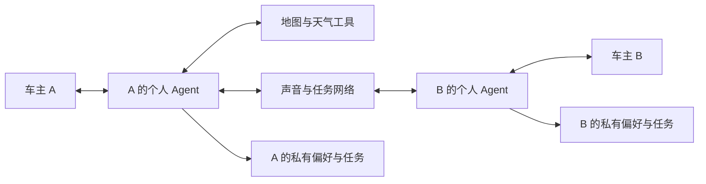

# 声呐：车主与个人 Agent 构成的语音互动网络

更新：2026-10-25。本轮用户澄清：**真人车主 + 自己的 AI Agent + 其他用户 + 其他用户的 Agent** 共同参与网络。不同需求选择不同回应来源，不要求每句话把 Agent TTS 和他人原声拼在一起。

每个 Agent 只管理自己主人的意愿、私有上下文和任务。平台可以共用模型与服务，双方状态仍各自独立。另一人的转写和原声是交流内容，不是给本人的工具指令。Agent 可以协调是否接收邀请、何时播放、等待哪一条回答，不能替对方伪造现场观察或真人发言。

## 需求与回应来源

| 用户需求 | 默认路径 | 有效回应 |
| --- | --- | --- |
| 某地天气、去公司路况 | 地图确定地点；天气/路线工具查询 | Agent 用自己的声音简短回答，注明来源、范围和时间 |
| 目的地的现场车位、工具无法覆盖的现场问题 | 目标解析 → 目的地附近的参与者 → 对方 Agent 按主人的意愿筛选 → 真人自愿回答 | 回传回答者的原生语音，保留来源与时间 |
| 明确要求“帮我问问那边的人” | 真人现场问答 | 不因地图有数据就替换用户明确要求的真人来源 |
| 想闲聊 | 独立的真人闲聊请求，匹配另一个明确想聊且当前可接收的用户 | 双方原声交流 |
| 暂未匹配到闲聊对象 | 询问“要我陪你聊吗？” | 只有主人明确接受后才进入 Agent 陪聊；拒绝不开始 |

工具失败不会自动变成一次公开提问：先问是否改向目的地的人询问。没有可靠原点就不估算去公司的路线；没有公司地址就先澄清，并只保存到本人的目的地别名中。区县天气不能当作某个停车场此刻是否下雨的传感器。

## 当前位置与目的地

询问目标与本人位置分开。提问者可以尚未出发，也可以正在远离该地点；回答资格仍要求对方确实在目标附近，位置新鲜且愿意互助。现场分享不能借远程提问能力绕过在场校验。

“前面景区”“那个地方”不自动解释为会话预选地点。“公司”也不是全体用户共享的地址。缺少关键信息时先一句澄清，不产生公开帖子、不通知错误地点的人。多个同名 POI 要求用户选择；不能默认选搜索第一项。澄清后公开的仍是原提问的真人原声，明确目标通过帖子地点信息传递，不能用 Agent TTS 重造用户的问题。

## 两种真人关系

现场问答沿实际 question → invitation → answer → reply 关系流转。目的地附近的用户是否收到邀请，继续由其参与意愿、关注、位置、时效和个人 Agent 的筛选共同决定。请求者等待自己任务的回答时，不需要身处目的地。

闲聊使用独立的请求、配对、消息与交付状态。“愿意帮助别人回答路况”不表示“愿意闲聊”。双方明确发出闲聊意愿后才配对；未配对、暂停、结束或过期的人不能被自动加入。配对消息只对双方可见，不进入公开广场，也不带走任何一方 Agent 的私人记忆。开始真人聊天后，普通发言发给当前车友；明确叫“声呐”或要求查询时才转回工具查询。

## 授权、出声与实现范围

新版自然交流入口说明了本次目的地发问、现场分享和真人闲聊的原声发送范围，发送和自动收听继续独立选择。旧会话的网络扩展默认关闭，不把之前的现场授权扩大为远程或闲聊授权。

普通发布、任务等待和真人原声交付仍不插入成功播报。地点澄清、工具答案和主人接受的 Agent 陪聊可以由 Agent 出声；真人回应使用原录音。两者都在用户开口、静音、通话或失去音频焦点时让路。真人音频不会转成 TTS，Agent 生成音频不会冒充真人原声。

本轮落地于服务端及 Android 自然交流入口；Linx MCP 增加只读地图/天气/路线能力。代码、真实供应商检查、模拟器和实体设备验收分别记录，见[实现与验证](../development/voice-network.md)。ESP32 固件接入和真实双人车内体验需要独立验收。
